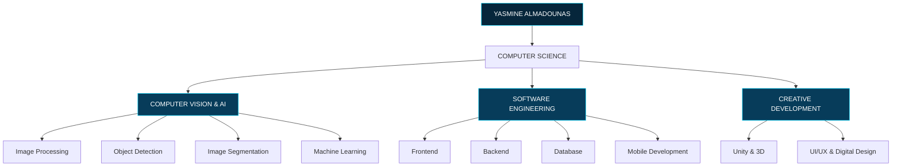

 <div align="center">


<br/>


<br/><br/>

[](https://github.com/almadounas-yasmine)
[](https://www.linkedin.com/)
[](mailto:YOUR_EMAIL)

</div>

---

<div align="center">

## `01 // SYSTEM IDENTITY`

**WELCOME TO MY DIGITAL WORKSPACE**

</div>

```python
class YasmineAlmadounas:

    def __init__(self):
        self.name = "Yasmine Almadounas"
        self.username = "almadounas-yasmine"
        self.education = "Master 2 - Computer Vision"
        self.location = "Algeria"

        self.specializations = [
            "Computer Vision",
            "Image Processing",
            "Artificial Intelligence",
            "Software Engineering"
        ]

        self.development = [
            "Full Stack Web Development",
            "Mobile Application Development",
            "Interactive 3D Applications"
        ]

        self.mindset = [
            "Curiosity",
            "Problem Solving",
            "Continuous Learning",
            "Creative Thinking"
        ]

    def mission(self):
        return "Build intelligent and meaningful technology."
```

I'm a Computer Science developer currently pursuing a **Master's degree in Computer Vision**, with a strong interest in Artificial Intelligence, image processing and software engineering.

My work combines analytical thinking, visual intelligence and software development. I enjoy designing complete solutions, from understanding a technical problem and developing an algorithm to building a functional application.

I am particularly interested in applying AI and Computer Vision to real-world challenges, including medical monitoring, environmental protection and intelligent systems.

**My philosophy:** Technology becomes meaningful when it solves real problems.

---

<div align="center">

## `02 // TECHNICAL EXPERTISE`

*What I know, what I build and how I use technology.*

</div>

### 👁️ 01. COMPUTER VISION & IMAGE PROCESSING

<sub>VISUAL INTELLIGENCE · IMAGE ANALYSIS · COMPUTER VISION</sub>

My main area of specialization is Computer Vision: enabling machines to interpret and extract meaningful information from visual data.

**Technical competencies:**

- **Image Processing:** Image enhancement, filtering, smoothing, edge detection and morphological operations.
- **Feature Extraction:** Identifying visual characteristics, contours, gradients and relevant image information.
- **Object Detection:** Understanding object localization and visual recognition workflows.
- **Image Segmentation:** Separating objects and regions of interest from complex backgrounds.
- **Video Processing:** Working with video streams, frame extraction and visual analysis.
- **OpenCV:** Developing image-processing pipelines and computer vision prototypes.

**Technologies:**


### 🧠 02. ARTIFICIAL INTELLIGENCE & MACHINE LEARNING

<sub>INTELLIGENT SYSTEMS · DATA · PREDICTION</sub>

I am interested in developing AI-based solutions that learn from data and support intelligent decision-making.

**Technical areas:**

- Understanding Machine Learning concepts and model workflows.
- Data preprocessing and preparation.
- Feature engineering and feature selection.
- Classification and prediction concepts.
- Exploring Deep Learning and neural network architectures.
- Evaluating model performance and analyzing results.
- Connecting AI models to practical software applications.

**Technologies and tools:**


### 💻 03. FULL STACK WEB DEVELOPMENT

<sub>FRONTEND · BACKEND · DATABASE INTEGRATION</sub>

I develop web applications by combining user interface design, application logic, backend development and database management.

**Frontend development**

- Building responsive and structured interfaces.
- Component-based development.
- Managing application state and user interactions.
- Creating dynamic interfaces and reusable components.
- Styling interfaces with modern CSS frameworks.

**Backend development**

- Designing application architecture.
- Building backend services and application logic.
- Developing REST API concepts and integrations.
- Handling authentication and data exchange.
- Connecting frontend applications to databases.

**Technologies:**


### 📱 04. MOBILE APPLICATION DEVELOPMENT

<sub>CROSS-PLATFORM · MOBILE INTERFACES · API INTEGRATION</sub>

I work on mobile applications designed to provide practical and accessible user experiences.

**Technical competencies:**

- Developing cross-platform mobile interfaces.
- Designing application navigation and screen structures.
- Integrating APIs and backend services.
- Managing user interactions and application states.
- Exploring camera-based features and real-time data integration.
- Connecting mobile interfaces with intelligent systems.

**Technologies:**


### 🗄️ 05. DATABASES & SOFTWARE ENGINEERING

<sub>DATA MANAGEMENT · APPLICATION ARCHITECTURE</sub>

I can work with relational databases and software development concepts to organize and manage application data.

**Technical competencies:**

- Relational database design.
- SQL queries and data manipulation.
- Table relationships and constraints.
- Data modeling and normalization concepts.
- Application architecture and modular code organization.
- Debugging, testing and version control.

**Technologies:**


### 🎮 06. 3D DEVELOPMENT & DIGITAL DESIGN

<sub>INTERACTIVE ENVIRONMENTS · VISUAL DESIGN · CREATIVE TECHNOLOGY</sub>

I also explore the intersection of programming, visual design and interactive experiences.

**Technical competencies:**

- Creating and exploring 3D environments.
- Working with 3D assets and scene composition.
- Designing interactive experiences.
- Understanding visual effects and image-processing techniques.
- Creating interface prototypes and graphic assets.

**Technologies:**


---

<div align="center">

## `03 // SKILL ARCHITECTURE`

**HOW MY TECHNICAL DOMAINS CONNECT**

</div>



---

<div align="center">

## `04 // SELECTED PROJECTS`

*Turning technical knowledge into practical applications.*

</div>

### 01 — AI MEDICAL MONITORING SYSTEM

`COMPUTER VISION` `OPENCV` `PYTHON` `FLUTTER`

An intelligent monitoring prototype focused on extracting and analyzing ECG visual information from a computer-screen video stream captured using a mobile camera.

**Key objectives:**

- Capture visual information from a video stream.
- Process ECG curves using OpenCV.
- Extract meaningful signal information.
- Connect the processing system to a mobile application.
- Explore notification and alarm mechanisms.

**Engineering focus:** Computer vision pipelines, visual signal extraction and mobile integration.

### 02 — EARLY SMOKE EMERGENCE DETECTION

`COMPUTER VISION` `AI` `IMAGE PROCESSING`

A research-oriented project focused on detecting early smoke emergence for wildfire warning under camera and environmental degradation.

**Key objectives:**

- Analyze visual indicators of smoke.
- Explore early detection strategies.
- Study image degradation and challenging environmental conditions.
- Investigate segmentation and visual analysis approaches.
- Explore reliable warning mechanisms.

**Engineering focus:** Early visual detection, segmentation and robustness under degraded conditions.

### 03 — 3D ALGERIAN GAME

`UNITY` `C#` `3D DEVELOPMENT`

An interactive 3D game inspired by Algerian environments, featuring an abandoned university atmosphere and immersive gameplay.

**Key objectives:**

- Build 3D environments.
- Develop interactive gameplay mechanics.
- Explore visual effects and image processing.
- Experiment with computer vision techniques for object visualization.
- Explore intelligent game agents.

**Engineering focus:** Game programming, real-time rendering and interactive systems.

### 04 — INTERACTIVE DATA VISUALIZATION

`D3.JS` `JAVASCRIPT` `DATA ANALYSIS`

A collection of interactive data visualization experiments using real datasets.

**Key objectives:**

- Load and process structured datasets.
- Create dynamic SVG visualizations.
- Build interactive scatter plots and pie charts.
- Explore data distributions and relationships.
- Develop responsive visualization layouts.

**Engineering focus:** Data-driven interfaces and visual analytics.

---

<div align="center">

## `05 // GITHUB ANALYTICS`

**MY OPEN-SOURCE ACTIVITY**


<br/>


</div>

---

<div align="center">

## `06 // CONTRIBUTION MATRIX`


</div>

---

<div align="center">

## `07 // CURRENT OBJECTIVES`

| Focus | Objective |
|:---|:---|
| Computer Vision | Explore detection and segmentation |
| Artificial Intelligence | Develop intelligent applications |
| Software Engineering | Build scalable applications |
| Research | Explore real-world AI challenges |
| Collaboration | Contribute to meaningful projects |

<br/>


</div>

---

<div align="center">

## `08 // ESTABLISH CONNECTION`

**Have an interesting project, research idea or internship opportunity?**

I'm open to connecting with developers, researchers, engineering teams and organizations working on innovative technologies.

<br/>

<a href="https://github.com/almadounas-yasmine">

</a>

<a href="https://www.linkedin.com/">

</a>

<a href="mailto:YOUR_EMAIL">

</a>

<br/><br/>

### `while(alive) { learn(); build(); innovate(); }`


**THANK YOU FOR VISITING MY DIGITAL WORKSPACE**

<sub>Designed with curiosity, code and creativity · Yasmine Almadounas · 2026</sub>

</div>
